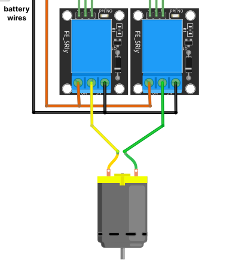

> An IOT project for controlling RC Car with Phone or PC using `WIFI`

### Requirements:
- Hardware:
    - An arduino (wemos d1 wifi)
    - Power bank (5V, 1A) for arduino 
    - A four module relay
    - small breadboard
    - diode
    - an old RC Car
    - a 6 volt battery for car motors
    - Jumper wires

- Software:
    - Arduino IDE for uploading sketch
    - Code editor (vs code)
    - nodejs >= version 12
    - npm 
    - java jdk + setting up java environment variables (only for building android app)

### Wiring
- connect pin 4,5,6,7 of the arduino with signal pins of the 4 module relay
- power up the relay from arduino on the pin with 5v along side with any ground pin (put the diode in between the arduino 5v pin and the vcc of the relay to make the current flows from arduino to relay board not the opposite)

- connect the two motors with the 4 module relay (nc,com,no) like this circuit below
<br/>

<br/>
    _the circuit shows connection of one motor with two relays (direction: forward, reverse), and we have two motors so we need 4 relays_

- plug-in the 5v 1a power bank to the arduino

### Uploading sketch
- open Arduino IDE 
- go to file > preferences > additional boards manager urls and add this url : http://arduino.esp8266.com/stable/package_esp8266com_index.json
- then go to tools > boards > boards manager and search for esp8266 by community and choose version 2.5.0
- select your board e.g. tools > boards > wemos d1 r1
- select port e.g. tools > port > /dev/ttyUSB0
- modify the mode of your board e.g. sudo chmod a+rwx /dev/ttyUSB0
- select upload speed e.g. tools > upload speed > 115200 
- add your [code](./sketch/car.ino) and click verify then upload (of course you need to modify the ssid and password to suit you wifi network)
- see if there are any errors in the logs down below and try to solve them

> Pro Tip: try to unplug any wires connected to arduino expect the usb cable while uploading your code to avoid any errors, also some errors maybe related to python symlinks

---

> After uploading sketch to arduino it will connect right away on your wifi network so you can check arduino internal `ip` and modify the [domain variable](./www/index.js) with arduino ip

## For controlling the car run below commands:

#### Getting started
```bash
npm i
```

#### Development server 
```bash
npm run serve
```

#### Build android app
```bash
npm run android
```

```bash
npm run build
```
